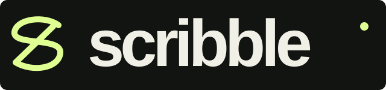

# Scribble — Streetwear

**001 / Tek marka. Farklı dünyalar.**

Bu dünyada Scribble bir streetwear markası. Aynı marka ve logo, her repoda farklı bir sektörün içinde yeniden hayal ediliyor.

Siyah sinema titlecard’ı, TR/EN arayüz, yüzen navbar, filtrelenebilir koleksiyon, yedi ürün detayı, demo sepeti, film arşivi, newsletter ve pop-up çalışması. E-posta, ödeme veya sipariş servisi bağlı değildir.

[Canlı site](https://mkochandev.github.io/scribble-streetwear/)

## Çalıştırma

Bağımlılık kurulumu gerekmez. Python 3 ve Node.js (JavaScript sözdizimi kontrolü için) yeterlidir.

```bash
python3 build.py
python3 -m http.server 8000 --directory dist
```

Tarayıcıda `http://localhost:8000` adresini açın.

```bash
npm run check
npm run build
```

`dist/` hazır statik çıktıdır. Yeni ürünler ve kaynaklar `assets/data.js`, etkileşimler `assets/app.js`, tasarım `assets/style.css` içindedir. Her ürünün ayrı HTML adresi vardır. `site.config.json` canonical / sitemap adresini tanımlar.

## Demo davranışı

- Dil ve sepet yalnızca bu tarayıcının `localStorage` alanında saklanır.
- Gerçek ödeme, stok kontrolü, sipariş, kargo veya kullanıcı hesabı yoktur.
- Newsletter e-postaları hiçbir yere gönderilmez veya kaydedilmez. Form sonucu bu durumu açıkça belirtir.
- Pop-up ilk ana sayfa ziyaretinde 26 saniye sonra, oturum başına bir kez açılır; footer düğmesinden yeniden açılabilir.
- Videolar kullanıcı tıklayınca Pinterest embed oynatıcısında açılır. Oynatıcı engellenirse orijinal Pin bağlantısı bulunur. Video dosyaları yeniden barındırılmaz. Ana ekrandaki SNORES filmi doğrudan kaynak sunucusundan sessiz ve döngüde oynar; durdurma düğmesi vardır. Hareket azaltma tercihinde otomatik başlamaz.
- Filtre, sıralama, beden seçimi, büyütme, sepet adedi / silme ve klavye ile kapatma çalışır.
- Hareket azaltma tercihi, klavye odağı ve mobil yerleşim desteklenir.

## Tasarım ve krediler

[Referanslar sayfası](dist/references.html) · [Kaynak listesi](docs/SOURCES.md) · [Sağlanan DESIGN.md](docs/DESIGN.md)

Ürün ve video görselleri orijinal marka / üreticilerine aittir. İsimler, fiyatlar ve bedenler konsept için örnektir. Atıf kullanım lisansı anlamına gelmez. Bilinmeyen hak sahipleri açıkça belirtilmiştir; bir ortaklık veya sponsorluk iddia edilmez.

## Yayın

Mevcut `.openai/hosting.json` aynı Site kimliğini korur. Kaynak değişikliklerinden sonra `python3 build.py` ile çıktıyı yenileyin. `dist/` herhangi bir statik sağlayıcıda sunulabilir. GitHub Pages için `gh-pages` dalının kökü yayınlanır. `main` kaynakları ve `dist` çıktısını tutar. Güncellemede `python3 build.py` çalıştırın ve `dist` içeriğini `gh-pages` dalının köküne aktarın. Pages ayarı: Deploy from a branch → gh-pages → /(root).

[Diğer Scribble dünyaları](https://mkochandev.github.io/) · [muham²ed](https://github.com/Mkochandev)
